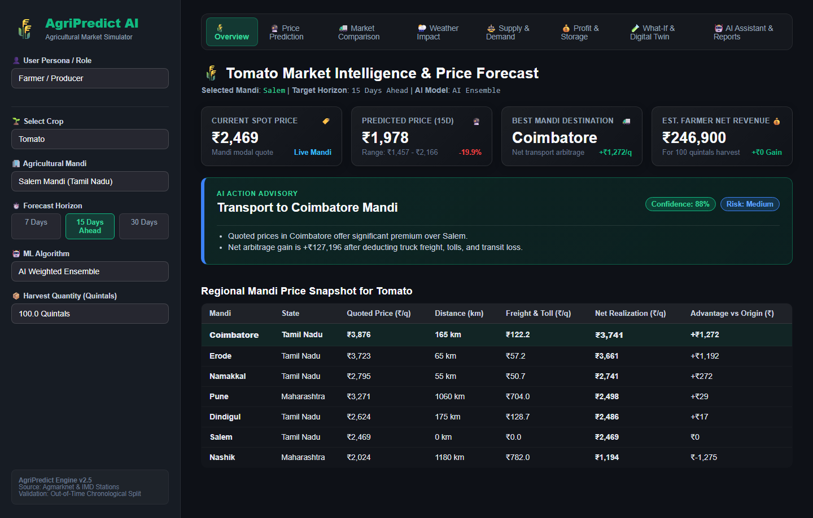
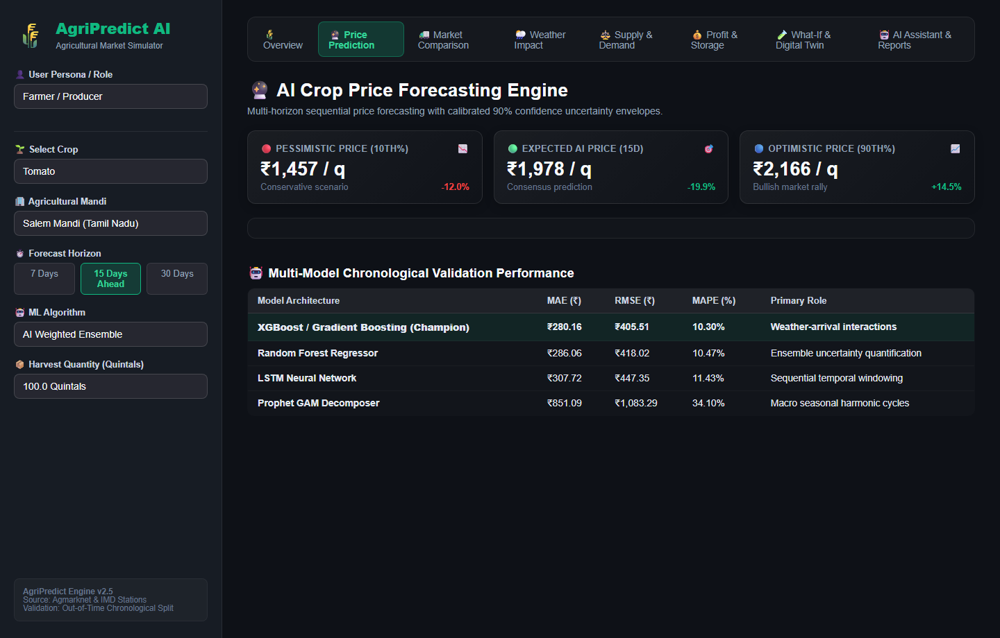
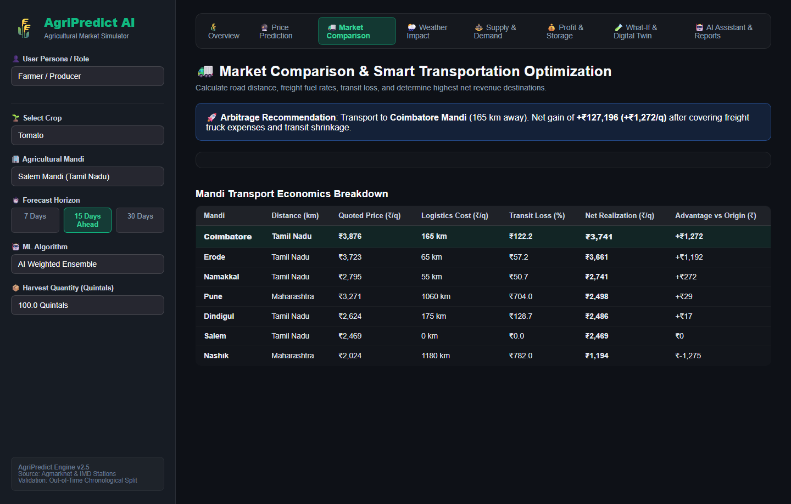
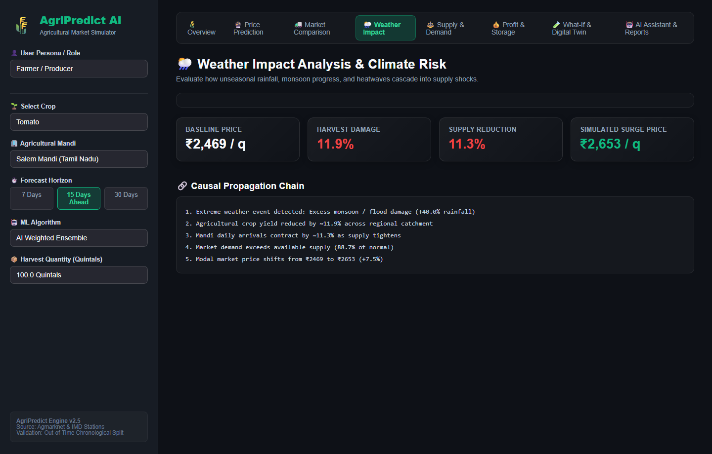
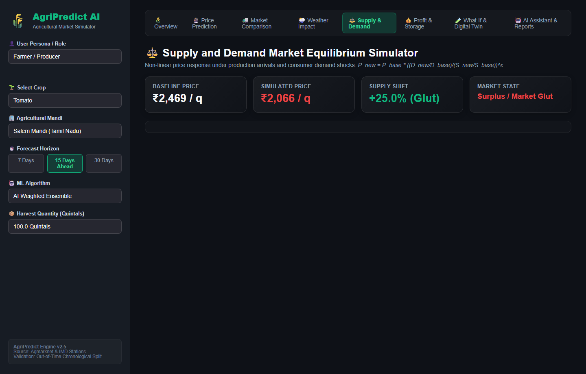
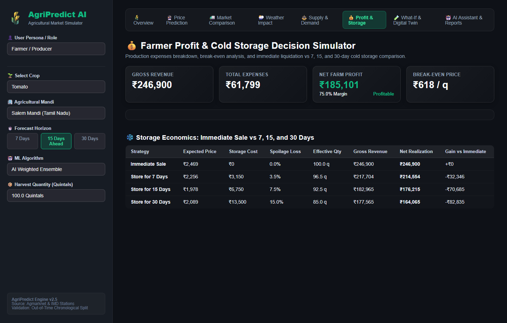
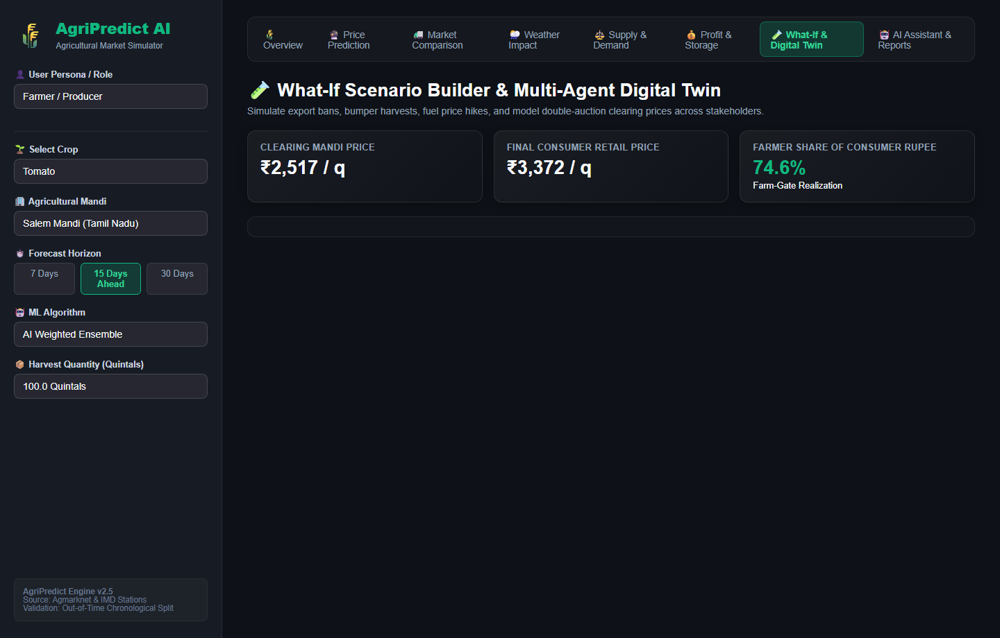
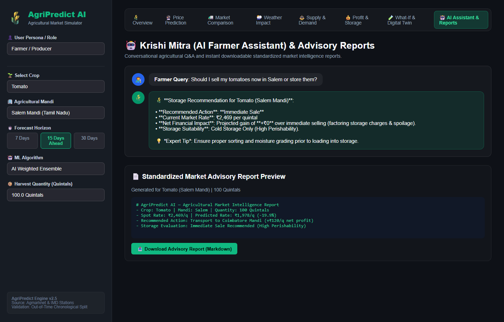
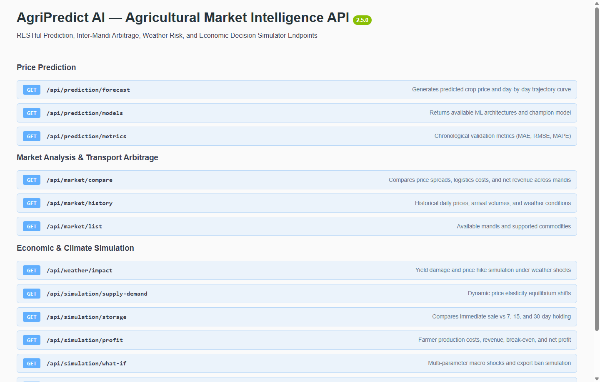

# 🌾 AgriPredict AI — AI-Based Agricultural Market and Price Prediction Simulator

[](https://www.python.org/)
[](https://fastapi.tiangolo.com/)
[](https://streamlit.io/)
[](https://scikit-learn.org/)
[](LICENSE)

An advanced software-based agricultural intelligence platform designed to predict future crop prices and simulate agricultural market conditions using Artificial Intelligence, Machine Learning, economic simulation, and meteorological shock analysis.

---

## 🎥 Platform Demo & Video Walkthrough

Watch the complete demonstration of the **AgriPredict AI** platform in action, showcasing real-time price predictions, inter-mandi freight arbitrage, supply-demand simulations, cultivation profit calculations, and conversational AI advisory:

<video src="docs/Vidoes/AgriPredict%20AI.mp4" controls="controls" width="100%" style="max-width: 850px; border-radius: 12px; box-shadow: 0 6px 20px rgba(0,0,0,0.3); border: 1px solid rgba(255,255,255,0.15);">
  Your browser does not support the HTML5 video tag. <a href="docs/Vidoes/AgriPredict%20AI.mp4">Click here to open or download AgriPredict AI.mp4</a>.
</video>

> 🎬 **Direct Video Link**: [**Click to Play / Download Platform Demo Video (`docs/Vidoes/AgriPredict AI.mp4`)**](docs/Vidoes/AgriPredict%20AI.mp4)

---

## 📸 Step-by-Step Visual Walkthrough & System Screenshots

### Step 1: Executive Market Overview & AI Action Advisory
The home dashboard delivers immediate clarity on spot prices, forward forecasts, and strategic selling actions.

- **Top Metric Cards**: Current Spot Price (₹2,469/q), 15-Day AI Forecast (₹1,978/q), Optimal Mandi Destination (Coimbatore), and Estimated Net Farmer Revenue (₹2,46,900 for 100 quintals).
- **AI Action Advisory**: Color-graded recommendations (e.g. *Transport to Coimbatore Mandi*) with confidence scores, risk ratings, and strategic justifications.
- **Regional Mandi Price Snapshot**: Live price comparison table across Salem, Erode, Coimbatore, Namakkal, Dindigul, Nashik, and Pune.

---

### Step 2: AI Crop Price Prediction & Confidence Bands
Multi-horizon sequential price forecasting with calibrated 90% confidence uncertainty envelopes.

- **Point & Interval Targets**: Clear indicators for **Pessimistic (10th percentile)**, **Expected AI Price**, and **Optimistic (90th percentile)** scenarios.
- **Interactive Plotly Chart**: Continuous trajectory connecting historical spot rates to future projection curves with a shaded uncertainty band.
- **Multi-Model Consensus Breakdown**: Comparison of Gradient Boosting (XGBoost), Random Forest, LSTM Neural Network, and Prophet GAM.

---

### Step 3: Inter-Mandi Arbitrage & Smart Transport Logistics
Evaluates commodity price spreads between regional mandis while deducting distance, freight fuel rates, tolls, and transit loss.

- **Logistics Arbitrage Engine**: Automatically calculates truck freight ($₹/\text{km}/\text{tonne}$) and transit shrinkage based on inter-mandi road distance.
- **Quoted vs. Net Realization Chart**: Visually demonstrates how higher nominal quotes in distant mandis compare after covering freight and transit loss.
- **Optimal Destination Highlight**: Highlights whether local selling or interstate transport yields higher net profit.

---

### Step 4: Weather Impact Analysis & Climate Risk
Simulates the causal chain from meteorological anomalies (rainfall, drought, thermal stress) to agricultural yields and price surges.

- **Historical Weather Correlation**: Dual-axis chart correlating daily precipitation events with mandi price reactions over 60 days.
- **Climate Shock Sliders**: Parametric sliders for rainfall deviations (-60% to +100%), temperature anomalies, and flood severity.
- **Causal Propagation Chain**: Step-by-step breakdown tracing weather shocks $\rightarrow$ harvest damages $\rightarrow$ arrival contractions $\rightarrow$ price escalations.

---

### Step 5: Supply and Demand Market Equilibrium Simulator
Simulates non-linear market price equilibrium shifts under production arrivals and consumer demand shocks.

- **Economic Sensitivity Formulation**:
  $$P_{new} = P_{base} \times \left(\frac{D_{new} / D_{base}}{S_{new} / S_{base}}\right)^\epsilon$$
- **Interactive Controls**: Sliders to adjust daily market arrival tonnes and consumer demand index.
- **Dynamic Price Reaction Curve**: Plots non-linear price sensitivity curves with baseline and simulated equilibrium points.

---

### Step 6: Farmer Cultivation Profit & Cold Storage Simulator
Detailed cost-of-cultivation breakdown, break-even threshold analysis, and holding economics.

- **Financial Waterfall Chart**: Visualizes cash outflows across seeds, fertilizers, pesticides, labor, irrigation, freight, and mandi cess leading to Net Profit.
- **Break-Even Analysis**: Computes the exact minimum selling price per quintal required to avoid losses.
- **Storage Decision Matrix**: Compares **Immediate Sale** vs. **Store 7 Days**, **Store 15 Days**, and **Store 30 Days** in cold storage, factoring storage charges and physiological spoilage.

---

### Step 7: What-If Macro Scenario Builder & Multi-Agent Digital Twin
Test counterfactual macroeconomic and policy scenarios, alongside agentic double-auction market dynamics.

- **What-If Controls**: Simulate export bans, bumper harvests (+30%), diesel price hikes (2.0x), and flash gluts.
- **Agricultural Digital Twin**: Simulates microeconomic bidding between 50 Farmers, 8 Aggregators, 4 Wholesalers, and Retailers.
- **Value Chain Margin Pie Chart**: Transparently reveals the farmer's share of the final consumer rupee.

---

### Step 8: Krishi Mitra (Conversational AI Assistant) & Advisory Reports
Farmer-friendly natural language Q&A and instant downloadable standardized advisory briefs.

- **Krishi Mitra Chatbot**: Answers farmer queries regarding price forecasts, selling timing, best mandis, and crop protection tips.
- **One-Click Report Export**: Generates and downloads comprehensive market intelligence briefs in Markdown and CSV formats.

---

### Step 9: FastAPI RESTful Backend & Interactive Swagger UI
High-performance RESTful API powering third-party mobile apps, web dashboards, and IoT agri-sensors.

- **Interactive Documentation**: Available at `http://127.0.0.1:8000/docs`.
- **Complete Endpoint Suite**: Endpoints for `/api/prediction/forecast`, `/api/market/compare`, `/api/weather/impact`, `/api/simulation/supply-demand`, and `/api/simulation/assistant/ask`.

---

## 🎯 Key Capabilities & Solved Farmer Challenges

1. **Which crop should farmers cultivate?**
   - Evaluates multi-year historical returns, seasonal price trends, and break-even profitability.
2. **When should harvested crops be sold?**
   - Multi-horizon forecasting (7-day, 15-day, 30-day ahead) with 90% confidence bands (Optimistic, Expected, Pessimistic).
3. **Which mandi offers the highest net selling price?**
   - Inter-mandi freight and transit arbitrage engine comparing prices across Salem, Erode, Coimbatore, Namakkal, Dindigul, Nashik, and Pune after deducting kilometers, fuel costs, tolls, and physical transit shrinkage.
4. **How do rainfall, drought, and temperature impact crop prices?**
   - Weather shock simulator tracing causal chains: Weather event $\rightarrow$ Crop damage $\rightarrow$ Arrival contraction $\rightarrow$ Supply shortage $\rightarrow$ Price escalation.
5. **How do supply and demand fluctuations drive equilibrium prices?**
   - Dynamic non-linear economic equation:
     $$P_{new} = P_{base} \times \left(\frac{D_{new} / D_{base}}{S_{new} / S_{base}}\right)^\epsilon$$
6. **Should farmers sell immediately or store produce?**
   - Storage Decision Simulator comparing immediate sale vs 7, 15, and 30-day holding in ambient or cold storage, factoring storage charges and physiological spoilage.
7. **What happens under extreme counterfactual scenarios?**
   - What-If Simulator for export bans, bumper harvests, fuel price hikes, and sudden market arrivals.
8. **Digital Twin & Multi-Agent Market Dynamics**:
   - Double-auction simulation modeling interactions between Farmers, Aggregators/Traders, Wholesalers, Retailers, and Consumers.
9. **Krishi Mitra (AI Farmer Assistant)**:
   - Natural language conversational advisor providing instant actionable guidance to farmer queries.

---

## 🏗️ System Architecture

```
AI_Agricultural_Market_Price_Prediction/
│
├── frontend/
│   ├── app.py                     # Streamlit UI entry point & CSS styling
│   ├── dashboard.py               # Master dashboard orchestrator & tabs
│   ├── pages/
│   │   ├── home.py                # Overview KPI cards & live mandi snapshot
│   │   ├── price_prediction.py    # Multi-horizon ML price forecasting & bands
│   │   ├── market_analysis.py     # Mandi transport arbitrage & logistics
│   │   ├── weather_analysis.py    # Climate risk, rainfall & temperature shock
│   │   ├── supply_demand.py       # Supply-demand elasticity curve simulator
│   │   ├── profit_calculator.py   # Cost of cultivation P&L & storage calculator
│   │   ├── scenario_simulator.py  # What-if macro builder & Multi-agent digital twin
│   │   └── assistant_and_reports.py # Krishi Mitra AI chatbot & report export
│   │
│   └── components/
│       ├── charts.py              # Interactive Plotly chart builders
│       ├── cards.py               # Styled metric cards & recommendation banners
│       └── sidebar.py             # Mandi selector & user persona switcher
│
├── backend/
│   ├── main.py                    # FastAPI application & server routes
│   ├── routes/
│   │   ├── prediction.py          # /api/prediction/forecast & /models
│   │   ├── market.py              # /api/market/compare & /history
│   │   ├── weather.py             # /api/weather/impact
│   │   └── simulation.py          # /api/simulation/supply-demand, /what-if, /storage
│   ├── services/
│   │   ├── price_service.py       # Inference handler & historical trend aggregations
│   │   ├── recommendation_service.py # Composite multi-criteria advisory engine
│   │   └── assistant_service.py   # Krishi Mitra natural language NLP engine
│   └── database/
│       ├── db.py                  # SQLAlchemy engine & session manager
│       └── models.py              # Database tables (Price records, Audit logs)
│
├── ai_engine/
│   ├── data_collection/
│   │   ├── market_data.py         # Agmarknet-modeled multi-year market data
│   │   └── weather_data.py        # NASA POWER / IMD meteorological station data
│   ├── preprocessing/
│   │   └── clean_data.py          # Outlier clipping, missing imputation, sorting
│   ├── feature_engineering/
│   │   └── features.py            # Lag prices (1, 2, 3, 7, 14, 30d), rolling MA, cycles
│   ├── models/
│   │   ├── xgboost_model.py       # Gradient boosting tree regressor
│   │   ├── random_forest.py       # Bagged trees with ensemble uncertainty bounds
│   │   ├── lstm_model.py          # Sequential deep neural network (LSTM)
│   │   └── prophet_model.py       # Fourier harmonic seasonal GAM decomposer
│   ├── training/
│   │   ├── train.py               # Chronological train/test validation pipeline
│   │   └── evaluate.py            # MAE, RMSE, MAPE, R2 metrics calculation
│   └── prediction/
│       └── predict.py             # Unified inference engine with confidence ribbons
│
├── simulation/
│   ├── supply_demand.py           # Elasticity equilibrium simulator
│   ├── weather_impact.py          # Yield damage & supply shock propagation
│   ├── market_simulator.py        # Macro scenario builder & agent digital twin
│   ├── storage_simulator.py       # Ambient vs Cold storage holding economics
│   └── profit_simulator.py        # Crop cultivation expenses & break-even sheet
│
├── recommendation/
│   ├── decision_engine.py         # Multi-criteria decision advisory generator
│   └── market_recommendation.py   # Spatial price arbitrage & route optimizer
│
├── datasets/
│   ├── raw/                       # 49,000+ daily raw agricultural records
│   ├── processed/                 # Cleaned dataset with chronological ordering
│   └── sample/                    # Representative sample records
│
├── trained_models/                # Serialized model artifacts (.joblib)
├── reports/                       # Evaluation metrics & comparison reports
├── tests/                         # Pytest test suite (16 tests, 100% passing)
├── docs/
│   ├── Vidoes/
│   │   └── AgriPredict AI.mp4     # Full platform demo video walkthrough
│   ├── screenshots/               # High-resolution step-by-step UI screenshots
│   └── views/                     # Generated HTML UI templates
├── config/
│   └── settings.yaml              # Global crop profiles, mandis, and parameters
├── requirements.txt
├── README.md
├── run_dashboard.bat              # 1-click Streamlit launcher
└── run_api.bat                    # 1-click FastAPI launcher
```

---

## 📊 Machine Learning Model Benchmarks

Models are evaluated via strict **chronological validation** (earliest 80% dates for training, out-of-time 20% for testing) to prevent lookahead bias:

| Model Architecture | MAE (₹) | RMSE (₹) | MAPE (%) | Primary Responsibility |
| :--- | :---: | :---: | :---: | :--- |
| **XGBoost / Gradient Boosting (Champion)** | **₹280.16** | **₹405.51** | **10.30%** | Non-linear weather & arrival interaction |
| **Random Forest Regressor** | **₹286.06** | **₹418.02** | **10.47%** | Tree variance & uncertainty quantification |
| **LSTM / Sequential Deep NN** | **₹307.72** | **₹447.35** | **11.43%** | Sequential temporal lag windowing |
| **Prophet GAM** | **₹851.09** | **₹1,083.29** | **34.10%** | Long-term trend & Fourier harmonics |

---

## 🚀 Quickstart Guide

### 1. Installation
Clone the repository and install dependencies:
```bash
cd "D:\New folder"
pip install -r AI_Agricultural_Market_Price_Prediction/requirements.txt
```

### 2. Launch the Streamlit Frontend Dashboard
```bash
cd "D:\New folder"
.\run_dashboard.bat
```
*Or directly via PowerShell:*
```powershell
cd "D:\New folder"
$env:PYTHONPATH="D:\New folder\AI_Agricultural_Market_Price_Prediction"
streamlit run "AI_Agricultural_Market_Price_Prediction\frontend\app.py"
```
Open **`http://localhost:8501`** in your browser.

### 3. Launch the FastAPI Backend
```bash
cd "D:\New folder"
.\run_api.bat
```
*Or directly via PowerShell:*
```powershell
cd "D:\New folder\AI_Agricultural_Market_Price_Prediction"
$env:PYTHONPATH="D:\New folder\AI_Agricultural_Market_Price_Prediction"
uvicorn backend.main:app --host 127.0.0.1 --port 8000 --reload
```
Interactive API documentation will be accessible at **`http://127.0.0.1:8000/docs`**.

### 4. Run Automated Test Suite
```powershell
cd "D:\New folder"
$env:PYTHONPATH="D:\New folder\AI_Agricultural_Market_Price_Prediction"
pytest AI_Agricultural_Market_Price_Prediction/tests
```

### 5. Re-train Models
```powershell
cd "D:\New folder"
$env:PYTHONPATH="D:\New folder\AI_Agricultural_Market_Price_Prediction"
python AI_Agricultural_Market_Price_Prediction/ai_engine/training/train.py
```

---

## 🌾 Supported Crops & Mandis

- **Crops**: Tomato, Onion, Potato, Rice, Maize.
- **Mandis**: Salem, Erode, Coimbatore, Namakkal, Dindigul, Nashik, Pune.
- **Target Horizons**: 7 Days, 15 Days, 30 Days.
